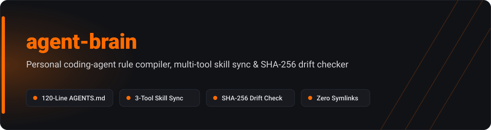
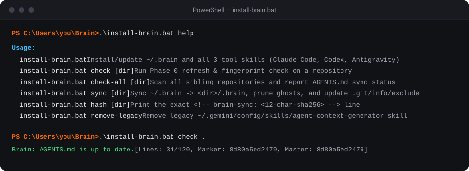
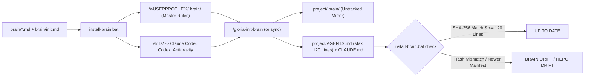

<div align="center">


# agent-brain

Personal AI coding-agent rule compiler, multi-tool skill sync, and SHA-256 drift checker for Windows.


<br /><br />



<br /><br />

[Features](#features) • [Screenshots](#screenshots) • [How it works](#how-it-works) • [Installation](#installation) • [Usage](#usage) • [Configuration](#configuration) • [Troubleshooting](#troubleshooting)

</div>

## About

`agent-brain` is an offline-only Windows PowerShell utility wrapped in a single `install-brain.bat` entry point with zero external dependencies and no administrator elevation or symlinks required. It keeps personal coding-agent rules in `brain/*.md`, mirrors them to `%USERPROFILE%\.brain\`, compiles the `gloria-init-brain` skill from `brain/init.md` for Claude Code, Codex, and Antigravity, and tracks rule drift across repositories using a deterministic 12-character SHA-256 `<!-- brain-sync: <hash> -->` fingerprint embedded in each project's `AGENTS.md`.

## Features

- **Single-source skill compilation** — `install-brain.bat` compiles `brain/init.md` into `skills/claude-code/`, `skills/codex/`, and `skills/antigravity/` (`gloria-init-brain/SKILL.md`), injecting tool-specific frontmatter and `$ARGUMENTS` syntax for Claude Code so the three tool copies stay in sync.
- **Multi-tool skill installation** — Installs `gloria-init-brain`, `gloria-github-release`, `gloria-github-repo-about`, and `gloria-github-repo-readme` directly into `C:\Users\you\.claude\skills\`, `C:\Users\you\.agents\skills\`, and `C:\Users\you\.gemini\config\skills\`, and removes legacy `init-brain` folders automatically.
- **Deterministic SHA-256 drift checking** — Normalizes rule files to LF, strips trailing newlines, and computes a 12-character hex digest (`<!-- brain-sync: <hash> -->`) verified by `check` and `check-all` alongside a 120-line budget check and manifest/workflow mtime drift detection.
- **Managed mirror with ghost pruning** — Syncing `~/.brain/` into `<project>/.brain/` overwrites stale rules, removes deleted master files, preserves untracked `local-*.md` project playbooks, and hides `.brain/` via `.git/info/exclude` instead of modifying `.gitignore`.
- **Trait-filtered rule compilation** — Supports `inline` rules (compiled into `## Personal Rules (Brain)`) and `reference` playbooks (one-line triggers under `## Playbooks (Read Before Task)`), with YAML `apply_when` traits and per-bullet `[trait]` tags.
- **Deterministic section ownership** — Refreshes regenerate `.brain/`-owned sections from scratch while preserving manual `## Repo Guardrails & Gotchas` entries; matching `**<Topic>:**` repo guardrails override conflicting `.brain/` rules.

## Desktop app

`npm run tauri:dev` (or the GloriaSetup installer from GitHub Releases) opens the Brain desktop app, a Tauri v2 window over the same files `install-brain.bat` uses:

- **Dashboard** — Scans repositories for brain drift, repo drift, 120-line budget and `.brain/` copy state. **Sync .brain/** counts only repos whose `.brain/` copy is out of date; BRAIN DRIFT and NO MARKER repos need `/gloria-init-brain` run inside them, and their cards offer a copy button for it.
- **Rules / Skills** — Edit `brain/*.md` and `skills/<tool>/*/SKILL.md` with a live fingerprint preview, then **Compile & Deploy**.
- **CLI's** — Detects Claude Code, Codex and Antigravity CLI (version, install source, exe path), checks winget for newer versions, installs or updates them, opens their config and skills folders, and edits `settings.json` / `config.toml` in place. JSON and TOML are validated before saving and a `.bak` copy is written first.
- **.gitignore** — One shared draft stored at `templates/gitignore` in this repo. Each git repository shows MISSING, MATCHES or DIFFERS, and one click writes the draft into it (an existing file is overwritten after a second confirm click).
- **Settings** — Brain repo path, scan roots and custom repositories.

## Screenshots

<p align="center">
  
  <br />
  <em>Silent CLI output from <code>install-brain.bat help</code> and <code>install-brain.bat check .</code> showing available subcommands, line budget, and SHA-256 sync marker verification.</em>
</p>

## How it works



## Installation

Clone the repository and run `install-brain.bat` from the repository root (or double-click it in Windows Explorer):

```powershell
.\install-brain.bat
```

In a single run, `install-brain.bat`:
1. Compiles `brain/init.md` into the three `skills/<tool>/gloria-init-brain/SKILL.md` files.
2. Mirrors `brain/*.md` and `install-brain.bat` into `C:\Users\you\.brain\`, pruning deleted non-`local-*.md` files.
3. Installs all skills under `skills/` into:
   - Claude Code: `C:\Users\you\.claude\skills\<skill>\SKILL.md`
   - Codex: `C:\Users\you\.agents\skills\<skill>\SKILL.md`
   - Antigravity: `C:\Users\you\.gemini\config\skills\<skill>\SKILL.md`
4. Prints the master `<!-- brain-sync: <12-char-sha256> -->` fingerprint and checks master rule files for unfilled `<...>` stub placeholders.

## Usage

### CLI (`install-brain.bat`)

| Command | Behavior |
|---|---|
| `.\install-brain.bat` | Compiles `gloria-init-brain/SKILL.md` from `brain/init.md`, mirrors `~/.brain/`, and installs all skills for all 3 tools |
| `.\install-brain.bat check [dir]` | Verifies `AGENTS.md` sync marker against the master SHA-256 fingerprint, line budget (`<= 120`), and manifest/workflow drift |
| `.\install-brain.bat check-all [dir]` | Scans all sibling folders (defaults to the parent of the repo) and prints a status table across repositories |
| `.\install-brain.bat sync [dir]` | Copies `~/.brain/*.md` into `<dir>/.brain/`, prunes deleted master files (preserving `local-*.md`), and adds `.brain/` to `.git/info/exclude` |
| `.\install-brain.bat hash [dir]` | Outputs the exact `<!-- brain-sync: <12-char-sha256> -->` marker for the target directory |
| `.\install-brain.bat remove-legacy` | Deletes the old `C:\Users\you\.gemini\config\skills\agent-context-generator` folder so it does not collide with `gloria-init-brain` |

### Agent Skill (`/gloria-init-brain`)

| Prompt | Behavior |
|---|---|
| `/gloria-init-brain` | Detects mode (Bootstrap, Initial generation, or Refresh), previews `AGENTS.md` and a report, and waits for `apply` before writing |
| `/gloria-init-brain check` | Read-only check reporting whether `AGENTS.md` matches the master brain fingerprint and repo state, then stops |
| `/gloria-init-brain learn <rule>` | Stages a new repo guardrail in `AGENTS.md` or global rule in `~/.brain/*.md`, previews the diff, and waits for `apply` |
| `/gloria-init-brain <project description>` | Bootstraps an empty folder with matching personal rules and stages `git init -b main` |

## Configuration

### Rule File Frontmatter (`brain/*.md`)

Every rule file in `brain/` (except `brain/init.md`) begins with YAML frontmatter:

```yaml
---
apply_when: desktop-gui, windows-app   # traits that activate this file
mode: inline                           # inline | reference
trigger: Before building an installer  # required for mode: reference
---
```

Recognized `apply_when` traits: `always`, `desktop-gui`, `windows-app`, `web-ui`, `browser-extension`, `android-app`, `cli-backend`, `has-github-remote`.

### Per-Bullet Trait Filters

Inside `mode: inline` files, individual bullets can restrict themselves to specific traits with a `[trait]` prefix:

```markdown
- [desktop-gui] **Window Chrome:** Disable native OS titlebars; build an integrated frameless titlebar...
- **Scrollbars:** Ban raw OS scrollbars; use thin (4–6px) themed scrollbars...
```

When compiled into a `web-ui` or `browser-extension` repo, `[desktop-gui]` bullets are omitted. In a `desktop-gui` repo, the `[desktop-gui]` prefix is stripped and the bullet is included.

### Project-Only Playbooks (`local-*.md`)

Syncing `<project>/.brain/` mirrors `~/.brain/` and removes files no longer present in `~/.brain/`. To keep an untracked, project-only playbook in `<project>/.brain/`, prefix its filename with `local-` (for example, `.brain/local-release-notes.md`).

### Repository Layout

- `install-brain.bat` — Hybrid batch/PowerShell CLI (`# --- POWERSHELL_START ---` payload) for installation, skill compilation, syncing, and drift checks.
- `brain/` — Canonical master rules (`workflow.md`, `commit-and-push.md`, `ui-preferences.md`, `building-the-project.md`, `github-actions.md`) and the tool-agnostic `init.md` prompt.
- `skills/` — Per-tool skill folders for `claude-code/`, `codex/`, and `antigravity/` (`gloria-init-brain`, `gloria-github-release`, `gloria-github-repo-about`, `gloria-github-repo-readme`).
- `templates/gitignore` — Shared `.gitignore` draft edited in the desktop app's .gitignore tab.
- `src-tauri/` — Rust backend for the desktop app (`brain_core.rs` drift and sync, `clis.rs` CLI detection and install, `gitignore.rs`, `rules.rs`, `skills.rs`, `config.rs`).
- `src/` — React + TypeScript UI for the desktop app.

## Troubleshooting

- **Edits to `skills/*/gloria-init-brain/SKILL.md` disappear after install:** `gloria-init-brain/SKILL.md` is generated from `brain/init.md`. Edit `brain/init.md` and re-run `.\install-brain.bat`.
- **Skill compilation throws `Could not find '## Non-Negotiable Rules'`:** `Sync-SkillFilesFromInit` slices `brain/init.md` at the exact `## Non-Negotiable Rules` heading. Keep that heading intact.
- **`check` reports `BRAIN DRIFT`, `NO MARKER`, or `OVER BUDGET`:** Run `/gloria-init-brain` in the affected repository to refresh `AGENTS.md` within the 120-line cap and update its `<!-- brain-sync: ... -->` footer, then confirm with `.\install-brain.bat check .`.
- **Antigravity invokes the old `agent-context-generator` skill:** Run `.\install-brain.bat remove-legacy` to remove `C:\Users\you\.gemini\config\skills\agent-context-generator`.
